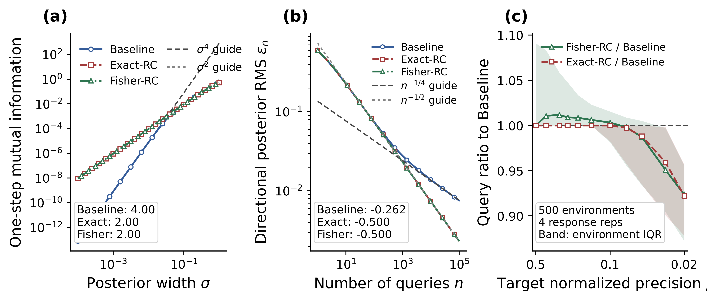

# PR-EIG Theoretical Experiments

Reproducible simulations for studying the information scaling and sequential
convergence of posterior-relative expected information gain (PR-EIG) under a
finite-noise multinomial logit (MNL) response model.

The repository compares PR-EIG with two physical-resolution calibration rules:

- **Exact-RC**, which directly maximizes exact expected information gain over a
  physical query radius;
- **Fisher-RC**, which chooses the radius by maximizing the exact scalar Fisher
  information at the posterior center.

The experiments isolate when posterior-relative query scaling loses information,
measure the resulting long-horizon convergence rate, and test whether the
calibrated rules remain useful in randomized multidimensional settings.

## Engineering highlights / 개발 환경 개선

실험 재현을 위해 seed·checkpoint·metadata·보고서 생성을 연결했습니다. query rule은 정확도뿐 아니라 계산 비용과 정밀도별 coverage까지 비교합니다. 이번 개발 환경 정리에서는 wheel에서 누락되던 `experiment1`을 포함하고, 기본 clone 이름에서 설치·테스트할 수 있도록 안내와 CI를 고쳤습니다.

[문제·선택·결과·학습 및 개발 가이드](docs/ENGINEERING.md) · [패키징·회귀 CI](.github/workflows/ci.yml)



## What is tested

The paper-facing experiment has three stages:

1. **Controlled information scaling** — exact quadrature measures how one-step
   information changes as posterior uncertainty decreases.
2. **Sequential consequence** — long-horizon simulations compare the resulting
   localization rates under a shared finite-`beta` MNL model.
3. **Randomized robustness** — paired multidimensional environments test query
   efficiency across dimensions, arities, inverse temperatures, anisotropy, and
   response-lapse rates.

A separate noiseless M-way coordinate-allocation benchmark is retained as an
appendix theorem check. It is not used as evidence for the noisy MNL rates.

## Main saved results

| Question | PR-EIG | Exact-RC / Fisher-RC |
|---|---:|---:|
| One-step information scaling | `O(sigma^4)`; fitted slope `3.995858` | `O(sigma^2)`; fitted slope `1.999991` |
| Sequential RMS scaling | approaches `O(n^-1/4)`; fitted slope `-0.261509` | `O(n^-1/2)`; fitted slopes `-0.499980` / `-0.499985` |
| Fine-precision query efficiency | baseline | median query ratios fall below one at `rho*=0.07`; median-bootstrap CIs are below one from `rho*=0.05` |

The retained `rho*=0.25` benchmark does **not** show a calibrated-method
query-count advantage. At finer precision the calibrated methods become more
useful, although coverage falls at the most demanding `rho*=0.02` threshold and
is reported explicitly.

Fisher-RC closely tracks Exact-RC while avoiding repeated EIG optimization. In
the saved uncached benchmark, median design times were `0.291 ms` for Fisher-RC,
`3.958 ms` for PR-EIG, and `4.789 ms` for Exact-RC.

See the generated [final report](outputs/experiment1/full/FINAL_REPORT.md) and
the detailed [experiment specification](FIGURE2_EXPERIMENT_DETAILS.md) for the
complete estimates, uncertainty intervals, diagnostics, and interpretation
limits.

## Model

For posterior-centered scalar coordinate `s`, physical radius `r`, inverse
temperature `beta`, and normalized template `b`, the response likelihood is

```text
P(Y=m | s,r) = exp[-beta (s-r b_m)^2]
               / sum_j exp[-beta (s-r b_j)^2].
```

The default `M=5` template begins with equal-mass standard-normal quantile
centers,

```text
b_m(raw) = Phi^-1((m+1/2)/M),  m=0,...,M-1,
```

then subtracts its floating-point mean and is rescaled to unit RMS. Likelihoods
are evaluated with max-shifted log-sum-exp.

## Repository layout

```text
.
├── experiment1/             # Final controlled, sequential, and randomized study
├── exp_a_information/       # One-step information-scaling experiment
├── exp_b_sequential/        # Sequential finite-noise localization experiment
├── exp_b_long/              # Long-horizon extension and replay checks
├── exp_c_noiseless/         # Separate noiseless allocation benchmark
├── plotting/                # Publication-figure loaders and renderers
├── tests/                   # Numerical and regression checks
├── outputs/                 # Tracked summaries, reports, and final figures
├── run_experiment1.py       # Staged paper-facing experiment entry point
├── run_all.py               # A/B/C smoke, paper, and exhaustive profiles
└── pyproject.toml           # Package metadata and dependencies
```

## Installation

Python 3.10 or newer is required.

```bash
git clone https://github.com/leejuyoung0918/pr-eig-theoretical-experiments.git
cd pr-eig-theoretical-experiments
python3 -m venv .venv
source .venv/bin/activate
python -m pip install -e '.[dev]'
python -m ruff check .
python -m pytest
```

Editable installation provides the `figure2_experiments` import name regardless
of the checkout directory name. Run the commands below from the repository root.
For figure commands that refer to saved paths, use `outputs/...` from this root.
The wheel includes experiment code; saved results remain in the Git checkout.

## Reproducing the final experiment

Start with the lightweight profile before launching the paper-quality run:

```bash
python -m figure2_experiments.run_experiment1 --mode quick --workers 4
python -m figure2_experiments.run_experiment1 --mode full --workers 8
```

Stages can be selected independently:

```bash
python -m figure2_experiments.run_experiment1 \
  --mode full \
  --components controlled sequential analyze report \
  --workers 8
```

Regenerate the final randomized panel and report from saved results:

```bash
python -m figure2_experiments.experiment1.plot --mode full --figure-c-only
python -m figure2_experiments.experiment1.report --mode full
```

All stages resume from deterministic batch or environment checkpoints unless
`--force` is supplied.

The `full` profile uses:

- 121 controlled `sigma` values;
- 200 sequential repetitions through 100,000 queries with 2,000 bootstrap
  samples;
- 500 randomized environments, four nested response replicates, and 2,000
  directional particles.

Runtime is hardware-dependent. On the recorded 8-worker Apple Silicon run, the
controlled and sequential stages took about `1.5 s` and `46 s`; the full
three-lapse randomized stage took about `421 s` after its reusable resolution
library and particle-count checks were available.

## Running the original A/B/C suite

```bash
python -m figure2_experiments.run_all --mode smoke
python -m figure2_experiments.run_all --mode paper --workers 8
python -m figure2_experiments.run_all --mode exhaustive
```

Useful controls:

```bash
python -m figure2_experiments.run_all --mode paper --experiments a c --skip-plot
python -m figure2_experiments.run_all --mode smoke --force
```

| Profile | A sigma/order | B trajectories x horizon | B bootstrap | C targets per `(d,M)` | Intended use |
|---|---:|---:|---:|---:|---|
| `smoke` | 41 / 128 | 20 x 256 | 200 | 4,000 | Plumbing and sanity checks |
| `paper` | 121 / 128 | 1,000 x 8,192 | 2,000 | 100,000 | Manuscript result |
| `exhaustive` | 181 / 256, down to `1e-5` | 2,000 x 16,384 | 5,000 | 1,000,000 | Precision/stress run |

### Long-horizon sequential extension

The publication B run can be extended from 8,192 to 65,536 queries without
overwriting the original result:

```bash
python -m figure2_experiments.run_exp_b_long
```

The extension first replays 20 trajectories and requires the saved checkpoint
fields and original `[512,8192]` slopes to agree within `1e-13`. It then runs
gated stages of 20, 100, and 1,000 trajectories.

## Rebuilding the publication figure

The plotter reads saved results only; it does not rerun an experiment or refit a
reported slope.

```bash
python -m figure2_experiments.plotting.plot_figure2 \
  --exp-a outputs/figure2/exp_a \
  --exp-b outputs/figure2/exp_b \
  --exp-c outputs/figure2/exp_c \
  --output outputs/figure2/figures/figure2_combined_final.pdf
```

To use the completed long-horizon B result, replace only `--exp-b`:

```bash
python -m figure2_experiments.plotting.plot_figure2 \
  --exp-a outputs/figure2/exp_a \
  --exp-b outputs/figure2/exp_b_long \
  --exp-c outputs/figure2/exp_c \
  --output outputs/figure2/figures/figure2_combined_long.pdf
```

## Outputs and repository size

Generated outputs live under the checkout’s `outputs/`. This Git repository
includes the human-readable reports, compact CSV/JSON summaries, diagnostics,
and final PDF/PNG figures required to inspect the saved conclusions.

Large reproducible artifacts are intentionally ignored to keep the repository
lightweight:

- raw Parquet trial tables;
- NumPy checkpoint files;
- experiment caches and per-environment raw records;
- Python and test caches.

Running an experiment recreates these files locally. The ignored files are not
required to inspect the committed reports and figures, but the raw data must be
regenerated before performing analyses that explicitly load it.

## Numerical and interpretation safeguards

- Experiment A uses deterministic Gauss-Hermite quadrature, with explicit
  64/128/256-order comparisons.
- PR-EIG and Exact-RC use the same logarithmic coarse search and bounded scalar
  refinement; search-boundary contact is recorded rather than hidden.
- Fisher-RC is evaluated with exact quadrature EIG at its Fisher-selected radius.
- Sequential policies share prior draws and round-by-round random variates.
- Fit windows are fixed in configuration before saved results are loaded.
- Numerical-floor flags remain present in generated raw outputs.
- Analytic curves and slope guides are labeled as theory and are never used as
  empirical observations.
- The randomized posterior is a projected particle assumed-density filter, not a
  claim of generic exact high-dimensional Bayesian inference.

## Further documentation

- [Detailed experiment design and results](FIGURE2_EXPERIMENT_DETAILS.md)
- [Final paper-facing report](outputs/experiment1/full/FINAL_REPORT.md)
- [Original A/B/C simulation report](outputs/figure2/REPORT.md)
- [Implementation inspection notes](experiment1/INSPECTION.md)
